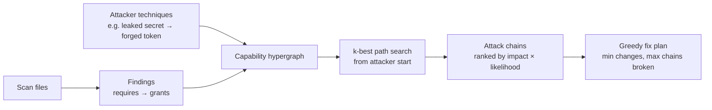

<div align="center">

# ⛓️ ChainBreaker

**Find attack chains, not just vulnerabilities.**

Security scanners hand you a list of 200 warnings. Attackers don't read lists: they *chain*.
ChainBreaker links the weaknesses in your code, config and containers into the actual paths an
attacker would walk, ranks them by what you'd lose, and tells you the **fewest fixes that break them all**.

[](https://github.com/rhizzyxvaici171-cloud/chainbreaker/actions/workflows/ci.yml)


</div>

---

## The idea in one example

Take three findings, each of which a normal scanner would file as medium or "informational":

| Finding | On its own |
|---|---|
| `subprocess.check_output(f"ping {host}", shell=True)` | "command injection, but only inside a container" |
| Dockerfile has no `USER` line | "best-practice warning" |
| `docker-compose.yml` mounts `/var/run/docker.sock` | "the deploy bot needs it" |

ChainBreaker sees what they add up to:

```
 CRITICAL  7.8  C2  → Root on the host server   3 steps, likelihood 57%
    start  Reach the app over the network
    1. Shell command built from input  app.py:54  [CB205]
       ⇒ Run arbitrary code in the app
    2. Container runs as root  Dockerfile:1  [CB301]
       ⇒ Root inside the app container
    3. Docker socket mounted into a container  docker-compose.yml:9  [CB302]
       ⇒ Root on the host server
```

…and tells you that removing **one line** from `docker-compose.yml` breaks 5 chains to host root:

```
 FIX PLAN  the fewest changes that break the most chains
  1. Docker socket mounted into a container  docker-compose.yml:9
     breaks 5 chain(s)  ·  closes: Root on the host server  ·  exposure 40 → 32.2
  2. CORS open to every origin  app.py:14
     breaks 1 chain(s)  ·  closes: Steal signed-in users' data from another site
  ...
  ✓ After these 13 fixes no attack chain reaches any goal (out of 16 findings).
```

## Quick start

```bash
pip install git+https://github.com/rhizzyxvaici171-cloud/chainbreaker
chainbreaker scan path/to/your/app --html report.html
```

Try it on the deliberately vulnerable demo shop in this repo:

```bash
git clone https://github.com/rhizzyxvaici171-cloud/chainbreaker
cd chainbreaker
python -m pip install -e .
chainbreaker scan examples/vulnerable-shop --html report.html
```

No dependencies, no network calls, no telemetry. Your code never leaves the machine.

## The interactive report

`--html` writes one self-contained file (no CDN, strict CSP, secrets redacted) with:

- **Fix plan**: the fixes in the order that removes the most risk first
- **Attack chains**: every path as a step-by-step flow from the attacker's starting point to the goal, filterable by outcome
- **Attack graph**: all chains merged into one layered graph; click a chain to highlight its route
- **All findings**: searchable, with evidence, location and how many chains each one feeds

**[See the live sample report for the demo shop →](https://rhizzyxvaici171-cloud.github.io/chainbreaker/sample-report.html)**

## How it works



1. **Rules turn weaknesses into capabilities.** Every finding states what an attacker needs before it is usable (`requires`) and what it hands over (`grants`). A committed DB password *requires* reading the source and *grants* database credentials. A published Postgres port *requires* network access and *grants* reach to the database.
2. **Techniques glue findings together.** Generic attacker know-how that isn't a bug by itself: "with DB credentials **and** DB reach, log in", "with code execution, read secrets from the environment", "with a signing secret, mint an admin token".
3. **The engine searches forward** from what any outsider has (`internet`, plus `source_read` if the repo is public) through a hypergraph where an edge fires only when *all* of its requirements are held. It keeps the *k* most likely derivations for every capability, so you see several distinct routes rather than one.
4. **Chains are scored** as `impact × (0.5 + 0.5 × likelihood)`. Impact comes from the goal (host root 10, DB wipe 9, RCE 8, admin 7…) and likelihood is the product of each step's confidence.
5. **The fix plan** removes one finding at a time, always picking the one that leaves the least reachable impact, then the fewest surviving chains, then the lowest total exposure. It stops when nothing reaches a goal.

### Threat model switches

```bash
chainbreaker scan . --private-repo          # attacker can't read your source...
```

…but then watch how a code-execution bug lets them read it anyway (technique T4) and use every hardcoded secret. That's a chain most tools can't show you.

```bash
chainbreaker scan . --assume internet,source_read,db_network   # e.g. attacker already inside the VPC
chainbreaker capabilities                                      # list everything the engine reasons about
```

## Rules

| ID | Detects | Requires → grants |
|---|---|---|
| CB101 | Cloud access key committed | source → cloud keys |
| CB102 | Database URL with password | source → DB credentials |
| CB103 | Private key committed | source → server key |
| CB104 | Hardcoded secrets (classified as signing secret / DB password / token) | source → … |
| CB201 | Flask/Werkzeug interactive debugger | network → RCE |
| CB202 | Django `DEBUG = True` | network → info leak |
| CB203 | Admin route with no auth (Flask, FastAPI, Express) | network → admin |
| CB204 | SQL built from f-strings/concatenation (Python, JS) | network → DB read/write |
| CB205 | Shell command built from input | network → RCE |
| CB206 | Unsafe deserialisation (`yaml.load`, pickle, eval…) | network → RCE |
| CB207 | CORS open to every origin | network → cross-site data theft |
| CB208 | JWT signature not verified / `alg: none` | network → forged sessions |
| CB301 | Container runs as root | RCE → container root |
| CB302 | Docker socket mounted | container root → host root |
| CB303 | Privileged container / `SYS_ADMIN` | container root → host root |
| CB304 | Database port published on all interfaces | network → DB reach |
| CB401 | Known-exploitable dependency versions (PyPI, npm) | network → depends on the CVE |

Silence a finding with a `chainbreaker:ignore` comment on its line. `chainbreaker rules` prints the full descriptions.

## Use it in CI

```yaml
# .github/workflows/chainbreaker.yml
name: ChainBreaker
on: [push, pull_request]
permissions:
  contents: read
  security-events: write   # only needed for the SARIF upload
jobs:
  scan:
    runs-on: ubuntu-latest
    steps:
      - uses: actions/checkout@v5
      - uses: rhizzyxvaici171-cloud/chainbreaker@main
        with:
          fail-on: critical          # fail the build on any critical chain
      - uses: github/codeql-action/upload-sarif@v3
        if: always()
        with:
          sarif_file: chainbreaker.sarif
      - uses: actions/upload-artifact@v4
        if: always()
        with:
          name: chainbreaker-report
          path: chainbreaker-report.html
```

The action writes a Markdown summary of the top chains and the fix plan to the job page, SARIF for GitHub code scanning, and the HTML report. Its inputs reach the shell through environment variables, never by templating into the script, so a crafted input can't inject commands.

## Output formats

| Flag | What |
|---|---|
| *(default)* | Coloured console report |
| `--html FILE` | Interactive, self-contained report |
| `--json FILE` | Everything: findings, chains, fix plan (`-` for stdout) |
| `--sarif FILE` | SARIF 2.1.0; each finding says which chains it feeds |
| `--markdown FILE` | Summary for PR comments / `$GITHUB_STEP_SUMMARY` |
| `--fail-on LEVEL` | Exit 1 if any chain is at least `low`/`medium`/`high`/`critical` |

## Honest limits

- Rules are pattern-based, not full data-flow analysis. A finding means "this looks exploitable"; the confidence on each step says how sure ChainBreaker is, and you should verify before you rely on it.
- The advisory list is deliberately small: just well-known, exploitable CVEs, so dependencies can take part in chains. Keep running `pip-audit` / `npm audit` for full coverage.
- Chains reason about one repository. They can't see your firewall, WAF or IAM policies; use `--assume` to describe your real exposure.

## Roadmap

- [ ] Import findings from Semgrep, Trivy, Gitleaks and pip-audit (SARIF in) and chain them
- [ ] Kubernetes manifests and Terraform (public buckets, wildcard IAM, open security groups)
- [ ] Optional OSV.dev lookup for the full dependency advisory database
- [ ] "What-if" mode: apply a fix in the report and watch chains disappear live
- [ ] Chain diff between two commits: "this PR opens a new path to the database"

## Development

```bash
python -m pip install -e .
python -m unittest discover -s tests -v
chainbreaker scan . --exclude examples,tests --fail-on low   # it scans itself in CI too
```

Adding a rule takes one decorated function in [`src/chainbreaker/rules.py`](src/chainbreaker/rules.py) that yields hits with `requires` and `grants`. The engine does the rest.

## Ethics

ChainBreaker is for finding and fixing weaknesses in systems you own or are authorised to test.
`examples/vulnerable-shop` is insecure on purpose and must never be deployed.

## License

MIT © Rhizzy X Vaici
